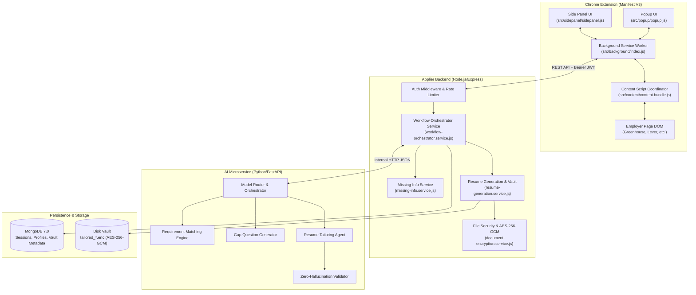

# Applier 3.0 — Final System Architecture Specification

## 1. Architectural Scope & Product Definition

Applier 3.0 is a specialized Chrome extension built to solve two specific problems:
1. **Job-Specific Resume Generation:** Compiles tailored, ATS-optimized LaTeX resumes derived strictly from verified user information.
2. **Application Form Filling:** Fills application forms directly on the active employer tab, attaches the generated resume, and presents a pre-submission review barrier.

There is no autonomous crawler, public job discovery engine, general-purpose chatbot, or third-party web scraper. All operations originate from the candidate's active browsing session.

---

## 2. Component Topology



---

## 3. The 23-Step End-to-End Workflow Sequence

The workflow guarantees that every resume claim and form answer is factually grounded.

```mermaid
sequenceDiagram
    autonumber
    actor User as Candidate
    participant Ext as Chrome Extension (MV3)
    participant Back as Backend Orchestrator
    participant AI as AI Microservice
    participant Vault as Encrypted Vault
    participant DOM as Employer Page DOM

    User->>Ext: 1. Authenticates & opens job tab
    Ext->>Back: 2. Request profile verification status
    Back-->>Ext: 3. Profile verified (or prompt resume upload)
    User->>Ext: 4. Opens job application page
    User->>Ext: 5. Clicks "Apply with Applier"
    Ext->>DOM: 6. Extracts job title, company, description
    Ext->>Back: 7. POST /api/v1/missing-info/session/init
    Back->>AI: 8. Match requirements vs verified profile evidence
    AI-->>Back: 9. Gap report (Required, High-Value, Optional)
    
    loop One Question at a Time
        Back-->>Ext: 10. Serve next prioritized gap question
        Ext-->>User: 11. Display question in Side Panel
        User->>Ext: 12. Answers or skips question
        Ext->>Back: 13. POST /session/:sessionId/submit-answer
        Back->>Back: 14. Update profile snapshot & tag USER_CONFIRMED
    end

    Back->>AI: 15. Generate tailored resume content
    AI->>AI: 16. Zero-Hallucination validation check
    AI-->>Back: 17. Validated LaTeX source & compiled PDF
    Back->>Vault: 18. Encrypt PDF with AES-256-GCM & save in Vault
    Back-->>Ext: 19. Resume ready; deliver decrypted PDF buffer
    Ext->>DOM: 20. Detect fields, map to profile, and autofill inputs
    Ext->>DOM: 21. Attach tailored PDF into file input
    Ext-->>User: 22. Display Pre-Submission Review Manifest
    User->>Ext: 23. Explicitly clicks "Confirm & Submit"
    Ext->>Back: 24. POST /session/:sessionId/confirm-submission
    Ext->>DOM: 25. Trigger final portal submission & capture receipt
    Ext->>Back: 26. POST /session/:sessionId/record-submission
```

---

## 4. Durable State Machine & Resilience

The workflow state machine is persisted in MongoDB (`MissingInfoSession` collection) across all steps:

```
INITIALIZING ──> CHECKING_PROFILE ──> QUESTIONS_PENDING ──> AWAITING_USER_RESPONSE
                       │                      │                       │
                (no profile)           (user answers)          (next question)
                       │                      ▼                       │
                       ▼              UPDATING_PROFILE ───────────────┘
            BLOCKED_BY_REQUIRED_INFO          │
                                              ▼
                                 READY_FOR_RESUME_GENERATION
                                              │
                                              ▼
                                      GENERATING_RESUME
                                              │
                                              ▼
                                      VALIDATING_RESUME
                                        │          │
                                 (failed)          (passed)
                                        │          ▼
                                        ▼  FILLING_APPLICATION
                                     FAILED        │
                                                   ▼
                                         AWAITING_USER_REVIEW
                                                   │
                                         (explicit user click)
                                                   ▼
                                         READY_FOR_SUBMISSION
                                                   │
                                                   ▼
                                               SUBMITTING
                                            ┌──────┴──────┐
                                            ▼             ▼
                                        SUBMITTED   SUBMISSION_STATUS_UNKNOWN
```

### Safe Failure Guarantee (`SUBMISSION_STATUS_UNKNOWN`)
If the network drops or the employer page redirects ambiguously during form submission:
1. The session enters `SUBMISSION_STATUS_UNKNOWN`.
2. Automatic retries are **strictly blocked**.
3. Re-submitting throws `Cannot submit application: Application is already in SUBMISSION_STATUS_UNKNOWN. Duplicate submission blocked.`.
4. The candidate is directed to verify their application status manually on the employer portal.

---

## 5. Security & Privacy Architecture

* **Multi-Tenant Isolation:** All operations enforce `{ sessionId, userId }`. Requests for documents belonging to another user ID are rejected.
* **At-Rest Vault Encryption:** Resume PDFs are encrypted with AES-256-GCM using unique 96-bit initialization vectors and 128-bit authentication tags.
* **Zero Remote Execution in Extension:** The extension contains zero `eval()` calls and loads no remote scripts, complying with Chrome Web Store MV3 CSP: `script-src 'self'; object-src 'self'`.
* **DOM Sanitization:** All text scraped from third-party employer portals is strictly sanitized to prevent AI prompt-injection or XSS attacks.
