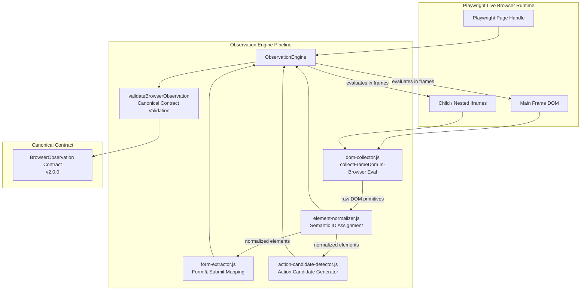

# Applier 2.0 — Phase 4: Live Browser Observation Engine Architecture

## 1. Overview & Objective

Phase 4 establishes the **Browser Observation Engine** within the `browser-worker` subsystem (`browser-worker/observation/`).

In legacy automation architectures, large raw HTML strings were passed directly to AI models or LLMs, resulting in:
1. Massive token consumption and latency bottlenecks.
2. Fragile element resolution dependent on brittle CSS selectors that break across dynamic re-renders.
3. Missing accessibility signals (ARIA labels, computed visibility, interactive roles, validation errors).

Phase 4 converts the **live browser itself into the authoritative source of truth**. A single in-browser evaluation extracts interactive elements, computed styles, accessible labels, options, and forms into a compact, structured **`BrowserObservation`** contract.

---

## 2. Directory Structure

```
browser-worker/observation/
├── dom-collector.js             # High-speed in-browser evaluation script (runs inside page context)
├── element-normalizer.js        # Normalizes elements & assigns stable semantic elementIds
├── form-extractor.js            # Groups forms, maps child elements, and detects submit triggers
├── action-candidate-detector.js # Generates candidate actions (CLICK, FILL, SELECT, UPLOAD)
├── observation-engine.js        # Central ObservationEngine orchestrator & schema validator
├── fixtures.js                  # 9 standalone HTML fixtures for comprehensive observation testing
└── index.js                     # Barrel export for observation package
```

---

## 3. Component Architecture & Data Flow



---

## 4. Element Model & Identity Principle

A core requirement of Phase 4 is: **Do not depend on CSS selectors as the identity of the element.**

In dynamic web applications (such as React, Vue, Angular, or complex portal frameworks), CSS selectors change frequently (dynamic hashes, autogenerated class names, altered sibling trees).

Instead, each element is given an immutable semantic record within the observation snapshot:

```typescript
interface NormalizedElement {
  elementId: string;         // Abstract semantic ID: "elem_1", "elem_2", ...
  tag: string;               // "input" | "button" | "select" | "textarea" | "a"
  role: string;              // Accessible role: "textbox" | "combobox" | "button" | ...
  type: string;              // "text" | "checkbox" | "radio" | "file" | "submit" | ...
  label: string;             // Resolved via label[for], wrapping label, aria-label, aria-labelledby, placeholder
  text: string;              // Inner visible text (trimmed, bounded)
  placeholder: string;       // Placeholder attribute
  name: string;              // Form field name attribute
  id: string;                // DOM element ID if present
  value: string;             // Current form value or checked status
  required: boolean;         // HTML5 required or aria-required
  disabled: boolean;         // Native disabled or aria-disabled
  visible: boolean;          // True computed visibility (display, visibility, opacity, rect, ancestors)
  options: Array<{           // For select and ARIA combobox/listbox
    text: string;
    value: string;
    selected: boolean;
  }>;
  attributes: Record<string, string>; // Pertinent attributes only (data-testid, aria-*, accept, pattern, etc.)
  framePath: string | string[];       // "root" or hierarchical iframe selector path
}
```

---

## 5. Normalized Observation Contract (`BrowserObservation`)

The resulting payload returned by `ObservationEngine.observe(page, options)` strictly conforms to `shared/schemas/browser-observation.json`:

```json
{
  "schemaVersion": "2.0.0",
  "observationId": "obs_64f1e582-72a3-4a12-8703-a15d2a98f123",
  "url": "https://scholarships.gov.in/portal",
  "title": "Scholarship Application Portal",
  "timestamp": "2026-10-03T11:45:00.000Z",
  "page": {
    "url": "https://scholarships.gov.in/portal",
    "title": "Scholarship Application Portal",
    "viewport": { "width": 1280, "height": 800 },
    "readyState": "complete",
    "visibleTextSummary": "Welcome to Scholarship Portal - Personal Information Form"
  },
  "elements": [
    {
      "elementId": "elem_1",
      "tag": "input",
      "role": "textbox",
      "type": "text",
      "label": "Applicant Full Name",
      "text": "",
      "placeholder": "Enter full name",
      "name": "fullName",
      "id": "fullNameInput",
      "value": "Alice Doe",
      "required": true,
      "disabled": false,
      "visible": true,
      "options": [],
      "attributes": {
        "data-testid": "name-input",
        "autocomplete": "name"
      },
      "framePath": "root"
    }
  ],
  "forms": [
    {
      "formId": "form_1",
      "id": "scholarshipForm",
      "name": "scholarshipForm",
      "action": "/api/apply",
      "method": "POST",
      "elementIds": ["elem_1", "elem_2", "elem_3"],
      "submitButtonId": "elem_3"
    }
  ],
  "actions": [
    {
      "actionId": "act_1",
      "type": "FILL",
      "elementId": "elem_1",
      "label": "Applicant Full Name",
      "framePath": "root"
    },
    {
      "actionId": "act_2",
      "type": "CLICK",
      "elementId": "elem_3",
      "label": "Submit Application",
      "framePath": "root"
    }
  ],
  "frames": [
    { "framePath": "root", "name": "", "url": "https://scholarships.gov.in/portal" }
  ],
  "metadata": {
    "observationDepth": "interactive",
    "collectedAt": "2026-10-03T11:45:00.000Z",
    "durationMs": 42.1,
    "elementCount": 3,
    "formCount": 1,
    "actionCount": 2,
    "visibleTextLength": 65
  },
  "screenshotReference": null
}
```

---

## 6. Performance & LLM Optimization

1. **In-Browser Execution**:
   - Extraction executes synchronously inside `page.evaluate(collectFrameDom)`.
   - Eliminates hundreds of Playwright IPC roundtrips (`page.$`, `element.getAttribute`, `element.isVisible`). Typical execution time: **5ms – 25ms** per page.
2. **Zero Raw DOM in Payloads**:
   - Raw HTML markup is completely stripped. Only structured semantic attributes are returned, reducing LLM token payloads by **85% – 95%**.
3. **Attribute Whitelisting**:
   - Only pertinent attributes are retained (`aria-*`, `href`, `accept`, `pattern`, `min`, `max`, `step`, `maxlength`, `minlength`, `autocomplete`, `data-testid`, `validationMessage`, `isInvalid`, `describedByText`).
4. **Configurable Observation Depth**:
   - `'interactive'` (default): Focuses on inputs, buttons, selects, links, textareas, and ARIA widgets.
   - `'forms_only'`: Restricts extraction strictly to forms and their inputs.
   - `'full'`: Includes structural headings, alerts, error text, and status banners.

---

## 7. Test Fixtures & Verification Matrix

The test suite in [`backend/tests/observation.test.js`](file:///f:/Applier/backend/tests/observation.test.js) verifies all 9 required scenarios:

| # | Test Scenario | Verified Capability | Status |
|---|---|---|:---:|
| 1 | **Simple HTML Form** | Native `<form>`, text, email, select, radio, checkbox, submit button mapping | PASS |
| 2 | **React SPA Form** | `data-testid`, controlled inputs, ARIA attributes, custom buttons | PASS |
| 3 | **Dynamic Form** | JavaScript DOM mutations (adding fields dynamically) captured upon re-observation | PASS |
| 4 | **Custom Dropdown** | ARIA `role="combobox"` and `role="listbox"` options parsed into `{ text, value, selected }` | PASS |
| 5 | **File Input** | `type="file"`, `role="file"`, `accept` constraints, `UPLOAD` action candidate | PASS |
| 6 | **Iframe Traversal** | Main page + child iframe traversal, elements annotated with hierarchical `framePath` | PASS |
| 7 | **Hidden Elements** | Computed visibility discriminates `display:none`, `visibility:hidden`, `opacity:0`, `type="hidden"` | PASS |
| 8 | **Disabled Fields** | `disabled` attribute and `aria-disabled="true"` tracking; exclusion from active actions | PASS |
| 9 | **Validation Messages** | Native HTML5 `validationMessage`, pattern mismatch, `aria-invalid`, `aria-describedby` feedback | PASS |

---

## 8. Repository Verification Results

- **Backend Jest Suite**: **80 / 80 passed** across 11 test suites (all contracts, queues, workers, session management, and observation engine).
- **AI Service Pytest Suite**: **33 / 33 passed**.
- **Frontend Vite Build**: Clean build in **1.02s**.
- **Scanning Backward Compatibility**: `PortalScanner` remains fully operational.

---

## 9. Boundary Compliance

- **No Laya**: Not implemented.
- **Phase 4 Complete**: Halted per instructions. Awaiting Phase 5 directions.
