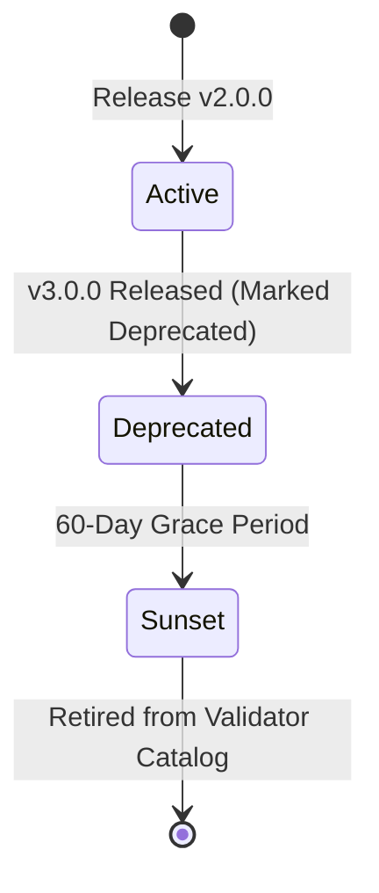

# Applier 2.0 — Contract Versioning & Evolution Strategy
**Document ID:** `ARCH-DOC-PHASE1-002`  
**Phase:** Phase 1 (Canonical Shared Contract Layer)  
**Status:** Approved & Implemented  
**Date:** October 2026  

---

## 1. Versioning Philosophy

In a distributed multi-service architecture spanning Node.js backend, Python AI agents, React browser client, and asynchronous automation runners, contract drift is the primary source of silent runtime failures.

Applier 2.0 enforces a **Semantic Contract Versioning** strategy (`MAJOR.MINOR.PATCH`):
- All canonical payloads MUST declare an explicit top-level `schemaVersion` attribute.
- Schemas in Phase 1 start at canonical version **`2.0.0`**.
- Contract validation occurs strictly at service ingress and egress boundaries.

---

## 2. Semantic Version Definitions for JSON Schemas

```
schemaVersion: "MAJOR.MINOR.PATCH"
                 │     │     │
                 │     │     └── Bug fixes, documentation, regex tightening that doesn't invalidate valid data
                 │     └──────── Additive backward-compatible changes (optional fields, new enum choices)
                 └────────────── Breaking changes (removed fields, newly required fields, type modifications)
```

### 2.1 MAJOR Version (`2.x.x` → `3.0.0`)
A MAJOR bump is triggered by any change that could cause existing consumers or producers to fail validation:
- Adding a **new required field** to an existing schema.
- **Removing or renaming** an existing field.
- **Changing the data type** of an existing field (e.g. `string` → `array`).
- **Removing a value** from an enum set.
- Tightening validation constraints that invalidate previously valid payloads.

### 2.2 MINOR Version (`2.0.0` → `2.1.0`)
A MINOR bump is backward-compatible:
- Adding a **new optional field** (`required` array is unchanged).
- Adding a **new enum option** where consumers are required to have fallback handlers.
- Loosening validation constraints (e.g. extending allowed character length).

### 2.3 PATCH Version (`2.0.0` → `2.0.1`)
A PATCH bump includes metadata changes that do not alter the shape of accepted data:
- Clarifying field descriptions and markdown docs inside the JSON Schema.
- Updating schema IDs or metadata.

---

## 3. Backward Compatibility & Migration Strategy

### 3.1 The Dual-Read / Single-Write Pattern
During version transitions across deployed services:
1. **Writers** (Producers) must immediately emit the latest supported canonical version (`2.0.0`).
2. **Readers** (Consumers / Validators) accept the latest version and optionally run legacy payloads through conversion adapters:

```
[Incoming Payload] 
       │
       ▼
 [schemaVersion?]
       │
       ├── "2.0.0" ─────────► [Ajv2020 / jsonschema Direct Validation] ──► Proceed
       │
       └── "1.0.0" / Legacy ─► [Adapter Translation Layer] ───────────────► Convert to 2.0.0 & Validate
```

### 3.2 Legacy Payload Adaptation
Legacy Applier 1.0 payloads lacked explicit `schemaVersion` attributes and nested workflow steps inside `schemaDefinition.pages`.

In Phase 1:
- The adapter layer (`shared/validators/adapters.js`) detects legacy documents from Mongoose and stamps `schemaVersion: "2.0.0"` while restructuring internal fields.
- External API calls that submit unversioned or invalid payloads are rejected at the controller gate with HTTP `400 Bad Request` and detailed Ajv diagnostic messages.

---

## 4. Deprecation Lifecycle

When a contract version is slated for replacement, it follows a 3-stage lifecycle:



1. **Active:** Fully supported, primary target for all services.
2. **Deprecated:** A newer MAJOR version exists. Emits telemetry warnings in logs when received; adapter automatically upcasts to current version. Minimum window: 60 days.
3. **Sunset / Retired:** Schema removed from registry. Requests with this version are rejected with `CanonicalValidationError: Unsupported schemaVersion`.

---

## 5. Schema Evolution Guidelines for Developers

### 5.1 Updating Python Pydantic Models (`ai-service/core/models.py`)
- When adding a new field, always provide a default value:
  ```python
  # CORRECT:
  newOptionalField: Optional[str] = Field(default=None, description="Added in v2.1.0")

  # INCORRECT (Breaks existing payloads):
  newRequiredField: str = Field(...)
  ```
- Use `validation_alias` with `AliasChoices` if accepting alternative naming variants from legacy clients.

### 5.2 Updating Mongoose Database Models (`backend/src/...`)
- Keep database schemas decoupled from wire schemas.
- If a new wire field needs persistence, update both:
  1. The Mongoose model schema.
  2. The adapter functions in `shared/validators/adapters.js`.

### 5.3 Modifying Canonical JSON Schemas (`shared/schemas/*.json`)
1. Create or edit the schema in `shared/schemas/`.
2. Ensure `$schema` is `"https://json-schema.org/draft/2020-12/schema"`.
3. Update `shared/fixtures/valid/` and `shared/fixtures/invalid/`.
4. Run Node contract tests: `npm test` in `backend`.
5. Run Python contract tests: `pytest tests/test_canonical_contracts.py` in `ai-service`.
