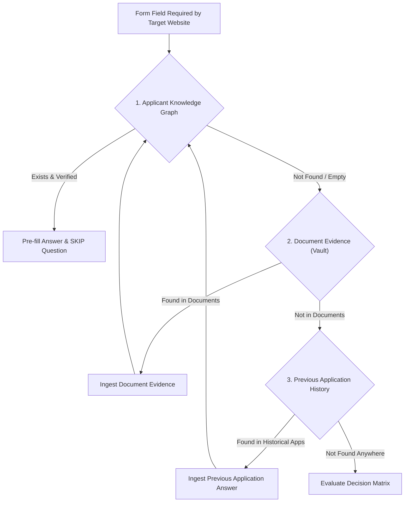

# Evidence-Aware Conversational Interview Architecture
## Applier 2.0 — Phase 14 Specification & Reference

---

### 1. Executive Summary

Phase 14 transforms the conversational intake workflow into an **Evidence-Aware Conversational Interview**. Rather than querying users for routine or already known applicant details, the interview system leverages the canonical **Applicant Knowledge Graph**, **Document Evidence**, and **Previous Application Data** to formulate an intelligent, non-redundant interview.

The system adheres strictly to the **Document-First Hierarchy** and the **Decision Matrix**, asking **exactly one question at a time** and ensuring verified data is never re-asked.

---

### 2. Architecture & Document-First Hierarchy

Before prompting the user for any form field, the system enforces a strict hierarchy:

#### Hierarchy Evaluation Order:
1. **Applicant Knowledge Graph**: Inspect canonical records across Identity, Contact, Address, Education, Family, Financial, Preferences, and Documents.
2. **Document Evidence**: Scan vault documents (`Document.find({ userId })`) for extracted values and high-confidence evidence (`importDocumentEvidence`).
3. **Previous Applications**: Re-use verified answers from prior submitted applications (`importPreviousApplications`).

---

### 3. Field Decision Matrix

For every required field on the target application portal, the evaluation maps to one of five deterministic actions:

| Condition | Verification Status | Confidence | Interview Action | User Experience |
| :--- | :--- | :--- | :--- | :--- |
| **1. Verified** | `VERIFIED` | $\ge 0.85$ | **SKIP** | Pre-fills into answers; never prompted. |
| **2. Known + High Confidence** | `VERIFIED` / `UNVERIFIED` | $\ge 0.85$ | **SKIP** (Show optionally in review) | Automatically pre-filled; question skipped. |
| **3. Known + Uncertain** | `CONFIRMATION_REQUIRED` | $< 0.85$ | **ASK CONFIRMATION** | `"We found that your [Field] is '[Value]'. Could you please confirm if this is correct?"` |
| **4. Conflicting Records** | `CONFLICT` | Any | **ASK USER TO RESOLVE** | `"⚠️ Conflicting records found for [Field]: '[Val A]' ([Source A]) vs '[Val B]' ([Source B]). Which one is correct?"` |
| **5. Missing / Unknown** | `UNKNOWN` | None | **ASK QUESTION** | `"Please provide your [Field]"` (with choices if options exist). |

---

### 4. Conversational Rules & Interaction Design

1. **Strictly ONE Question at a Time**:
   - The conversational interview identifies `state.pendingFields[0]` as `state.currentField`.
   - The AI only prompts the user for the single active field per conversational turn.
2. **Reuse Existing Answers**:
   - Answered fields are recorded in `state.answers` and appended to `state.completedFields`.
   - Answered and skipped fields are permanently removed from `state.pendingFields`.
3. **Affirmation Intelligence**:
   - For confirmation questions, affirmations (e.g. *"yes"*, *"correct"*, *"yep"*, *"confirm"*) automatically accept the known candidate value, elevate confidence to `1.0`, mark status `VERIFIED`, and advance to the next field.
4. **Conflict Resolution**:
   - For conflict questions, when the user designates a choice or specifies an override, the conflict is marked `RESOLVED` in the graph with an audit record (`resolvedBy: 'USER'`), and the selected value is saved to answers with `1.0` confidence.

---

### 5. Resuming Conversational Interviews

When an interview session is paused or interrupted:
- `POST /api/v1/interview/resume` (invoking `resumeInterview(userId, interviewStateId)`).
- Reconciles remaining `pendingFields` against any knowledge updates performed in the background.
- If all pending fields were satisfied, marks `status: 'COMPLETED'`.
- Otherwise, sets `currentField` to the first unresolved field and delivers:
  > *"Welcome back! Let's continue where you left off. [Current Question]"*

---

### 6. Scalability & Verification

The suite was verified under large-scale conditions:
- **55+ Field Scalability**: Tested with 55 distinct fields across all 8 domains. With 50 fields pre-verified, the partitioner completes in under 30ms, skips 50 fields instantly, and executes sequential turns for the remaining 5 fields without hallucination or regression.
- **Automated Regression Suite**:
  - `backend/tests/conversational-interview.test.js`: 11/11 passing.
  - `backend/tests/application-review.test.js`: 10/10 passing.
  - `backend/tests/action-policy.test.js`: 15/15 passing.
  - `backend/tests/knowledge-graph.test.js`: 7/7 passing.
  - `backend/tests/contract.test.js`: 49/49 passing.
  - Python AI suite: 63/63 passing.
  - Frontend Vite build: Passing (1.50s).
