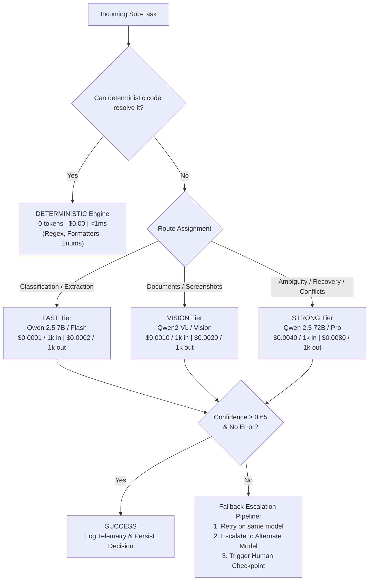
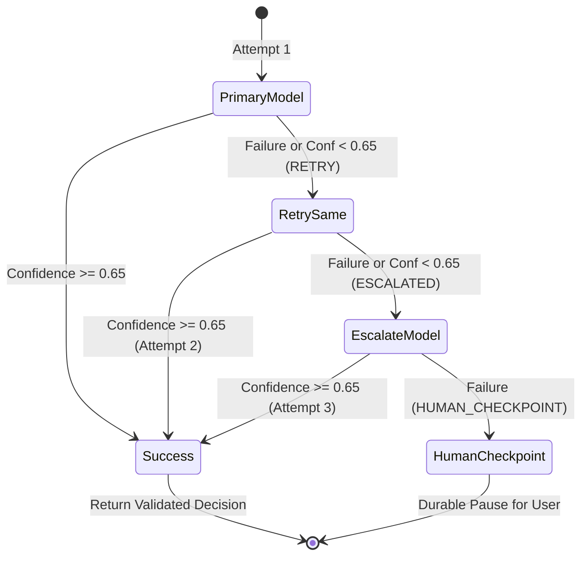

# Multi-Model AI Routing Architecture
**Applier 2.0 — Phase 22**

---

## 1. Executive Summary

In Applier 2.0, autonomous job application workflows comprise dozens to hundreds of disparate sub-tasks: from normalizing telephone numbers and dates to analyzing passport scans, inspecting dynamic modal overlays, and resolving conflicting semantic profile evidence.

Invoking massive frontier reasoning models (e.g. 72B+ parameters) for every micro-operation incurs excessive latency, high token usage, and prohibitive operational cost. Conversely, employing lightweight models for complex multi-page recovery or conflicting legal declarations leads to high failure rates.

**Multi-Model AI Routing** implements an intelligent tiered routing topology with **deterministic pre-emption**, ensuring every task is dispatched to the least expensive and least reasoning-intensive tier capable of resolving it with high confidence.



---

## 2. Routing Tiers & Model Allocations

| Tier | Primary Model | Alternate / Escalation Model | Eligible Task Types | Cost per 1k in / out (USD) |
| :--- | :--- | :--- | :--- | :--- |
| **`DETERMINISTIC`** | `deterministic-rule-engine` | N/A (Escalates to FAST) | Phone normalization (E.164), date conversion (ISO), gender/boolean parsing, exact option classification, regex PAN/Aadhaar/email extraction | **$0.00 / $0.00** (0 tokens) |
| **`FAST`** | `qwen-2.5-7b-instruct` | `qwen-2.5-72b-instruct` | `CLASSIFICATION`, `NORMALIZATION` (unstructured), `SIMPLE_EXTRACTION` (freeform NLP) | $0.0001 / $0.0002 |
| **`VISION`** | `qwen2-vl-72b-instruct` | `gemini-1.5-flash-vision` | `DOCUMENT_ANALYSIS`, `SCREENSHOT_ANALYSIS`, `VISUAL_UI` | $0.0010 / $0.0020 |
| **`STRONG`** | `qwen-2.5-72b-instruct` | `gemini-1.5-pro` | `AMBIGUITY_RESOLUTION`, `COMPLEX_WORKFLOW`, `RECOVERY`, `CONFLICTING_EVIDENCE` | $0.0040 / $0.0080 |

---

## 3. The Deterministic Pre-emption Rule

> [!IMPORTANT]
> **Deterministic Rule**: *Do not use an LLM when deterministic code is sufficient.*

Whenever an incoming task can be solved via closed-form string manipulation, regular expressions, or static schema lookups, the router completely bypasses all LLM calls:
1. **Phone Normalization**: Strips punctuation, detects domestic 10-digit formats, and applies canonical E.164 (`+15551234567` or `+919876543210`).
2. **Date Standardization**: Transforms `DD/MM/YYYY`, `MM-DD-YYYY`, `YYYY/MM/DD`, and textual dates into strict ISO 8601 `YYYY-MM-DD`.
3. **Boolean & Gender Coercion**: Normalizes affirmative/negative values (`yes`, `true`, `1`, `y`) and gender identifiers (`MALE`, `FEMALE`, `OTHER`).
4. **Structured Extractions**: Extracts emails, PAN cards (`[A-Z]{5}[0-9]{4}[A-Z]`), and Aadhaar numbers (`\d{4}\s?\d{4}\s?\d{4}`) using deterministic regex filters.
5. **Exact Classification**: Maps exact case-insensitive matches directly to candidate option sets.

**Impact**: Eliminates 100% of LLM network round-trips and token expenditures for repetitive formatting operations.

---

## 4. Multi-Level Fallback Pipeline

If an AI model invocation encounters a transient error, timeout, or produces ambiguous output (confidence score $< 0.65$), the system transitions through a deterministic 3-stage fallback pipeline:



1. **Attempt 1 (Primary Model)**:
   - Dispatches payload to selected model tier.
   - If successful and confidence $\ge 0.65$, completes execution.
   - If failed or low confidence, records `{ attempt: 1, model, error, status: 'RETRY' }`.
2. **Attempt 2 (Retry on Same Model)**:
   - Retries against primary model with refreshed prompt/exponential backoff.
   - If successful, returns success with full fallback history.
   - If failed, records `{ attempt: 2, model, error, status: 'ESCALATED' }` and escalates to alternate tier/model (e.g. FAST $\to$ STRONG, or primary STRONG $\to$ secondary STRONG).
3. **Attempt 3 (Alternate / Strong Model)**:
   - Dispatches payload to higher-capacity frontier model.
   - If successful, returns completed decision.
   - If failed, records `{ attempt: 3, model, error, status: 'HUMAN_CHECKPOINT' }`.
4. **Human Checkpoint**:
   - Durable checkpoint triggered (`humanCheckpointRequired: true`) with explicit diagnostic reasoning (`humanCheckpointReason`).
   - Prevents silent failures, halluncinations, or incorrect form submissions.

---

## 5. Canonical Telemetry Contract

Every execution produces an immutable telemetry record adhering to the canonical JSON Schema (`shared/schemas/model-routing-decision.json` `v2.0.0`):

```json
{
  "schemaVersion": "2.0.0",
  "decisionId": "mrd_4a8b19f07c2d",
  "taskType": "CLASSIFICATION",
  "route": "STRONG",
  "selectedModel": "qwen-2.5-72b-instruct",
  "tokens": {
    "inputTokens": 280,
    "outputTokens": 60,
    "totalTokens": 340
  },
  "latencyMs": 312.4,
  "costUsd": 0.001600,
  "confidence": 0.9650,
  "success": true,
  "fallbackHistory": [
    { "attempt": 1, "model": "qwen-2.5-7b-instruct", "error": "Low confidence (0.48)", "status": "RETRY" },
    { "attempt": 2, "model": "qwen-2.5-7b-instruct", "error": "Low confidence (0.52)", "status": "ESCALATED" },
    { "attempt": 3, "model": "qwen-2.5-72b-instruct", "error": null, "status": "SUCCESS" }
  ],
  "humanCheckpointRequired": false,
  "humanCheckpointReason": null
}
```

---

## 6. Verification and Test Results

### Node.js Backend Suite
- **Contract Tests**: 61/61 tests passing (`tests/contract.test.js`), verifying registration and canonical schema validation for `model-routing-decision.json`.
- **Model Routing Suite**: 12/12 tests passing (`tests/model-routing.test.js`), verifying:
  - Deterministic pre-emption for phone, date, boolean, gender, and regex extractions.
  - FAST, VISION, and STRONG routing rules.
  - Pricing calculation and token telemetry tracking.
  - Full fallback loop (transient retry, low-confidence escalation, fatal human checkpoint).
- **Full Backend Regression**: 28/28 suites passed (271/271 tests passing).

### Python AI Service Suite
- **Model Router Tests**: 11/11 tests passing (`tests/test_model_router.py`).
- **Canonical Schema Alignment**: 26/26 contract tests passing (`tests/test_canonical_contracts.py`).
- **Full AI Service Regression**: 78/78 tests passing across all test modules.

### Frontend
- **Production Build**: Clean Vite build succeeded with 0 errors (`dist/index.html`, `dist/assets/`).
