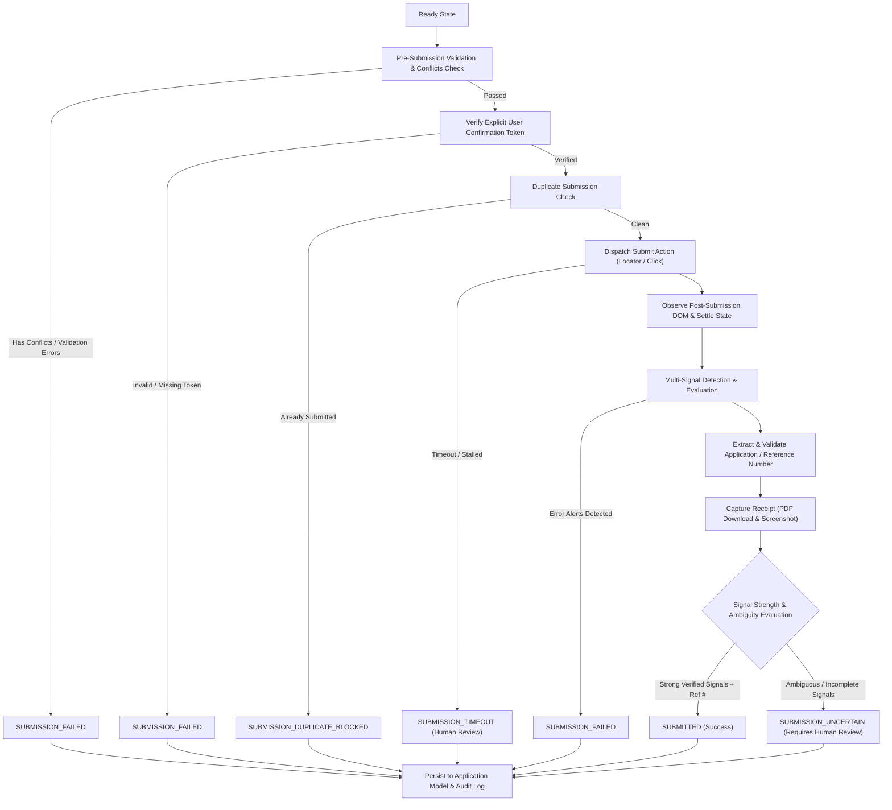

# Applier 2.0 — Phase 17: Verified Submission and Receipt Capture

## 1. Overview & Objective

Phase 17 implements **Verified Submission and Receipt Capture** for Applier 2.0. In legacy automation systems, clicking a submit button and receiving a 200 HTTP code or observing a click event was often mistakenly treated as a successful submission.

> [!IMPORTANT]
> **Core Principle:** A successful click is **NOT** equivalent to successful submission.

Submission is a non-reversible, high-stakes boundary in the application lifecycle. Phase 17 replaces blind clicks with deterministic multi-signal verification, reference number extraction, downloadable receipt capture, full-page visual evidence, and duplicate submission protection.

---

## 2. Canonical Submission Lifecycle



---

## 3. Multi-Signal Success Detection

To establish verifiable truth without relying on brittle single-point assumptions, the engine monitors and synthesizes **six distinct signals**:

| Signal Type | Verification Mechanism | Concrete Evidence Extracted |
| :--- | :--- | :--- |
| `SUCCESS_PAGE` | Headings (`<h1>`, `<h2>`, `<h3>`, `[role="heading"]`) & page title matching confirmation patterns. | Confirmation heading text (e.g., *"Application Submitted Successfully"*). |
| `CONFIRMATION_TEXT` | Body text scan matching explicit positive confirmation patterns. | Confirmation sentence (e.g., *"We have received your application."*). |
| `APPLICATION_NUMBER` | Regex extraction of reference identifiers (`APP-...`, `REF-...`, `Application No: ...`) with sanity filters. | Unique alphanumeric identifier (e.g., `APP-2026-987654`). |
| `RECEIPT_DOWNLOAD` | DOM search for downloadable anchor tags or print links (`href*=".pdf"`, `button:has-text("Download Receipt")`). | Download URL, filename, and file type (`PDF` / `HTML`). |
| `URL_TRANSITION` | Transition away from form submission URL to a dedicated success route (`/confirmation`, `/success`, `/submitted`). | Target confirmation URL. |
| `DOM_STATE` | Verification that interactive input controls (`input`, `select`, `textarea`) have been removed/cleared. | Active input count = 0, DOM state hash update. |

> [!WARNING]
> **Visual Evidence Guard:** Never rely on screenshot alone! Full-page screenshots provide supporting audit trails, but deterministic verification requires alphanumeric reference matching and DOM state transitions.

---

## 4. Ambiguity Protocol

If a portal redirects to an unexpected page (e.g., home page or generic landing dashboard) without clear error banners but also lacking explicit confirmation text or an application number:

1. **Never Falsely Claim Success:** The engine strictly forbids guessing or assuming success based on a lack of error banners.
2. **Move to `SUBMISSION_UNCERTAIN`:** The submission is classified as `SUBMISSION_UNCERTAIN`.
3. **Require Human Review:** The flag `requiresHumanReview: true` is set, and confidence is reduced (< 0.50).
4. **Trigger Recovery / Checkpoint:** The applicant and operator are alerted to verify the portal state manually or via assisted recovery.

---

## 5. Duplicate Submission Protection

Accidentally clicking submit more than once can result in double billing, rejected applications, or disqualification.

- Before dispatching any submit click, `VerifiedSubmissionEngine` queries the in-memory application context and MongoDB `Application` record.
- If an existing record for `applicationId` is already in status `SUBMITTED` with a verified reference number:
  - The submit click is **immediately aborted**.
  - Status is set to `SUBMISSION_DUPLICATE_BLOCKED`.
  - The existing reference number and confirmation details are preserved.
  - No network or browser request is sent to the form button.

---

## 6. Receipt Availability Handling

Portals exhibit differing receipt download mechanisms:

1. **Receipt Download Available:**
   - Link or PDF download is identified.
   - Receipt metadata is recorded: `{ available: true, receiptUrl: '...', receiptType: 'PDF' }`.
   - Full-page receipt screenshot captured.
2. **Receipt Download Unavailable:**
   - Some institutions display an on-screen acknowledgement without a downloadable PDF.
   - Status remains `SUBMITTED` if confirmation text and reference number are verified.
   - Receipt metadata records `{ available: false, reason: 'NO_RECEIPT_DOWNLOAD_FOUND' }`.
   - Full-page receipt screenshot is captured as the visual receipt proof.

---

## 7. Canonical Schema (`verified-submission.json` v2.0.0)

All results conform strictly to `shared/schemas/verified-submission.json`:

```json
{
  "$schema": "https://json-schema.org/draft/2020-12/schema",
  "$id": "https://applier.ai/schemas/v2/verified-submission.json",
  "title": "VerifiedSubmission",
  "type": "object",
  "required": [
    "schemaVersion",
    "submissionId",
    "applicationId",
    "submissionStatus",
    "submittedAt",
    "confidence",
    "requiresHumanReview"
  ],
  "properties": {
    "schemaVersion": { "type": "string", "const": "2.0.0" },
    "submissionId": { "type": "string" },
    "applicationId": { "type": "string" },
    "jobId": { "type": "string" },
    "submissionStatus": {
      "type": "string",
      "enum": [
        "SUBMITTED",
        "SUBMISSION_FAILED",
        "SUBMISSION_UNCERTAIN",
        "SUBMISSION_TIMEOUT",
        "SUBMISSION_DUPLICATE_BLOCKED"
      ]
    },
    "submittedAt": { "type": "string", "format": "date-time" },
    "referenceNumber": { "type": ["string", "null"] },
    "confirmationUrl": { "type": ["string", "null"] },
    "receipt": {
      "type": ["object", "null"],
      "properties": {
        "available": { "type": "boolean" },
        "receiptUrl": { "type": ["string", "null"] },
        "receiptFilename": { "type": ["string", "null"] },
        "receiptType": { "type": ["string", "null"] },
        "receiptSummary": { "type": ["string", "null"] },
        "capturedAt": { "type": "string", "format": "date-time" },
        "reason": { "type": ["string", "null"] }
      }
    },
    "receiptScreenshot": { "type": ["string", "null"] },
    "finalPageEvidence": {
      "type": "object",
      "properties": {
        "url": { "type": "string" },
        "pageTitle": { "type": "string" },
        "confirmationHeading": { "type": ["string", "null"] },
        "confirmationText": { "type": ["string", "null"] },
        "signalsDetected": { "type": "array", "items": { "type": "string" } },
        "errorSignals": { "type": "array", "items": { "type": "string" } },
        "urlTransitioned": { "type": "boolean" },
        "domStateHash": { "type": "string" }
      }
    },
    "confidence": { "type": "number", "minimum": 0, "maximum": 1 },
    "requiresHumanReview": { "type": "boolean" }
  }
}
```

---

## 8. Verified Execution Engine Integration

The `VerifiedExecutionEngine` natively supports the `submit` action type:

```javascript
case 'submit': {
  const submitResult = await this.verifiedSubmissionEngine.submitAndVerify({
    page,
    action: step,
    context: {
      jobId: state?.jobId || step.jobId,
      applicationId: state?.applicationId || step.applicationId,
      confirmationToken: step.confirmationToken || state?.confirmationToken,
      hasConflicts: step.hasConflicts ?? false,
      hasValidationErrors: step.hasValidationErrors ?? false,
      expectedPageState: step.expectedPageState
    }
  });
  step.actualResult = submitResult;
  step.submissionResult = submitResult;
  break;
}
```

The `ActionVerifier` inspects the resulting payload:
- `verifySubmit`: validates `submissionStatus === 'SUBMITTED'`.
- If status is `SUBMISSION_UNCERTAIN` or `SUBMISSION_FAILED`, the verification fails and routes to recovery or human intervention.

---

## 9. Verification & Test Matrix

All required scenarios are verified deterministically in `backend/tests/verified-submission.test.js`:

1. **`success`**: Complete flow with reference number extraction (`APP-2026-987654`), receipt PDF link capture, screenshot evidence, and `SUBMITTED` status.
2. **`failure`**: Pre-submission conflict halts, validation error halts, invalid token rejection, and post-submission DOM error banner detection (`SUBMISSION_FAILED`).
3. **`timeout`**: Submit observation and network hanging conditions cleanly transitioning to `SUBMISSION_TIMEOUT` with `requiresHumanReview: true`.
4. **`ambiguous submission`**: Redirection to dashboard without clear receipt or reference number transitions cleanly to `SUBMISSION_UNCERTAIN`.
5. **`duplicate submission protection`**: Pre-existing submitted application halts before click with `SUBMISSION_DUPLICATE_BLOCKED`.
6. **`receipt unavailable`**: Portals lacking download links successfully capture full-page screenshots and record `receipt: { available: false, reason: 'NO_RECEIPT_DOWNLOAD_FOUND' }` while maintaining `SUBMITTED`.
7. **`execution loop integration`**: End-to-end multi-step workflow execution through `VerifiedExecutionEngine` and `ActionVerifier`.
