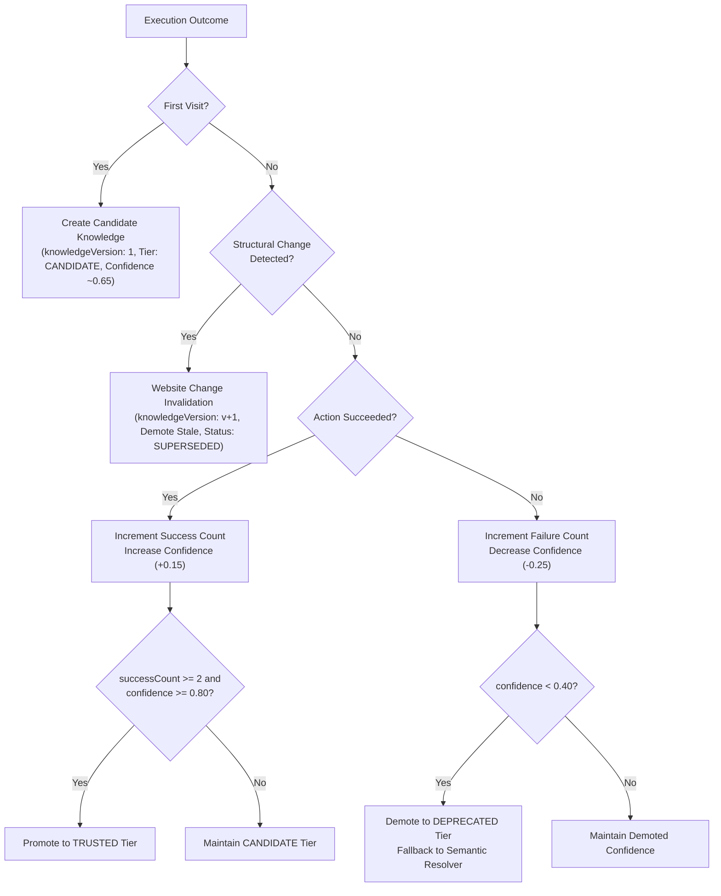

# Applier 2.0 — Website Fingerprinting and Learning

## 1. Overview and Core Objectives

Historically, browser automation systems treat websites as static targets with hardcoded selectors or execute plans blindly from scratch on every run. When websites shift slightly, brittle selectors fail; conversely, caching unverified user inputs or blind selectors introduces significant reliability and security hazards.

Phase 19 introduces **Website Fingerprinting and Learning**, a closed-loop system designed to:
- Learn successful portal behavior across repeated applications.
- Version portal knowledge and detect structural layout divergence.
- Validate candidate assumptions through repeated verified successes before promoting them to trusted status.
- Demote failing and stale locators gracefully while preserving resilient fallback to semantic resolvers.
- Strictly prevent the storage of sensitive secrets (raw passwords, OTP values, CAPTCHAs, PII).

---

## 2. WebsiteFingerprint Data Structure

Stored per portal/domain, the canonical contract (`shared/schemas/website-fingerprint.json` `v2.0.0`) captures durable, versioned operational knowledge without storing volatile user secrets.

### Stored Components:
1. **Domain & Portal Identity**: Target host, portal type (e.g. Workday, Greenhouse, Lever, TCS iON, Custom), and a structural DOM layout hash (`structuralHash`).
2. **Knowledge Versioning**: Semver or monotonic integer (`knowledgeVersion`) representing the schema generation.
3. **Page Fingerprints**: Signatures for distinct steps (landing, application form, document upload, review, success) identified by URL patterns, title patterns, and DOM element layout signatures.
4. **Semantic Fields**: Field-level registry mapping high-level semantic targets (e.g. `applicant.fullName`) to learned strategies, confidence scores, success/failure counts, and knowledge tier (`CANDIDATE`, `TRUSTED`, `DEPRECATED`).
5. **Successful Locator Strategies**: High-confidence, validated locator shortcuts for zero-latency execution.
6. **Workflow Transitions**: Validated actions transitioning between pages (e.g. `fromPage: "APPLICATION_FORM"`, `toPage: "SUCCESS_PAGE"`, `triggerAction: "click(#submit)"`).
7. **Upload Constraints**: Observed file format requirements, maximum upload file sizes in bytes, and file extension accept lists.
8. **Checkpoint Behavior**: Learned checkpoint triggers (OTP, CAPTCHA, manual review, payment) including typical form step locations and frequency.
9. **Recovery Strategies**: Successful self-healing tactics per failure type (e.g., dismiss modal, re-observe, scroll into view).

---

## 3. Strict Security & Privacy Invariants

> [!IMPORTANT]
> **No Sensitive Data Persistence**: The fingerprinting engine strictly forbids storing raw passwords, OTP codes, CAPTCHA answers, or sensitive user identity details.

- All execution data passes through an automated sanitization pipeline (`sanitizeKnowledge`).
- Fields matching sensitive target patterns (e.g., `password`, `pin`, `otp`, `captcha`, `secret`, `ssn`, `aadhaar`, `pan`) are scrubbed of raw values.
- Only the structural locator method and element presence are recorded—never the user's secret values.

---

## 4. The Learning Lifecycle

### Knowledge Tiers
- **`CANDIDATE`**: Hypothesized strategy learned from an initial run. Used with caution and monitored for repeatability.
- **`TRUSTED`**: Strategy validated through repeated verified successes (`successCount >= 2` and `confidence >= 0.80`). Prioritized by the locator engine for high-speed resolution.
- **`DEPRECATED`**: Broken or outdated strategy whose confidence fell below 0.40 due to failures. Never returned as a recommendation; forces fallback to semantic discovery.

---

## 5. Website Change Detection and Versioning

Websites continuously evolve. When an enterprise updates its portal:
1. `computeStructuralHash` computes a deterministic signature of the page DOM layout and action components.
2. If `detectWebsiteChange` discovers that the live page layout signature diverges from the stored `portalIdentity.structuralHash`:
   - The current knowledge is invalidated and marked as `SUPERSEDED`.
   - A new knowledge version is created (`knowledgeVersion: v + 1`, `status: ACTIVE`).
   - Stale locators and page fingerprints are demoted back to `CANDIDATE` with reduced confidence.
   - The system re-learns the updated portal layout without crashing or blindly applying outdated assumptions.

---

## 6. Verification and Test Matrix

The test suite (`backend/tests/website-fingerprinting.test.js`) verifies all 6 core scenarios:

| Test Case | Scenario Verified |
| :--- | :--- |
| **1. First Visit** | Establishes candidate knowledge on unknown portal; sets `knowledgeVersion: 1`, `tier: CANDIDATE`; passes canonical contract validation. |
| **2. Repeat Visit** | Matches domain and structural hash; reuses knowledge; promotes candidate to `TRUSTED` upon repeated verified successes. |
| **3. Website Change** | Detects DOM structural divergence; bumps `knowledgeVersion`; marks old version `SUPERSEDED`; demotes stale locators. |
| **4. Stale Locator** | Detects broken locator on shifted element; decrements confidence; demotes to `DEPRECATED`; falls back to semantic resolution. |
| **5. Successful Learning** | Validates multi-step form fields, transitions, upload constraints, and recovery strategies across multiple executions. |
| **6. Failed Learning & Security** | Decreases confidence on failures; strictly strips raw passwords, OTP values, and CAPTCHAs from persistence. |
