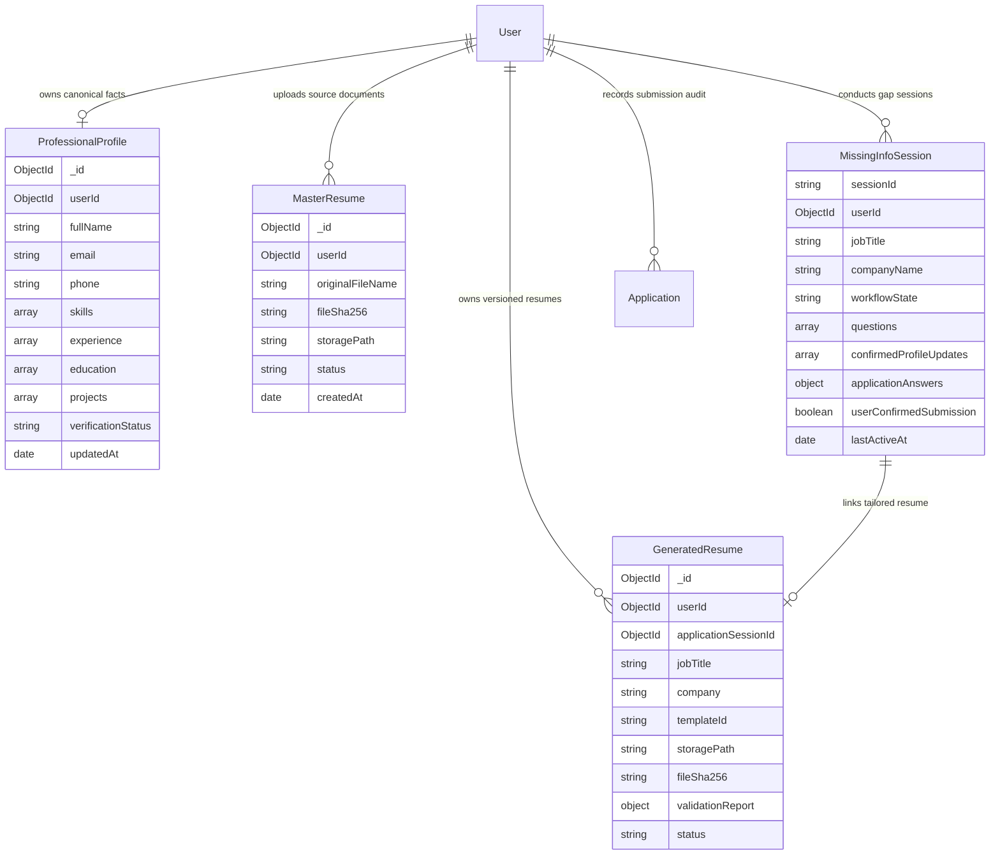

# Database Schemas & Migration Guide — Applier 3.0

This guide documents the MongoDB schema architecture for Applier 3.0, contrasts them with legacy 1.0/2.0 structures, and outlines the migration procedure for existing user accounts.

---

## 1. Schema Overview

Applier 3.0 introduces a normalized, provenance-tracked data model designed for strict factual fidelity and AES-256-GCM document encryption.



---

## 2. Model Specifications

### 2.1 `ProfessionalProfile` (`backend/src/users/professional-profile.model.js`)
The canonical single source of truth for candidate qualifications:
* **`userId`:** `ObjectId` (Indexed, unique per user).
* **`personalInfo`:** `fullName`, `email`, `phone`, `location`, `linkedin`, `github`, `portfolio`.
* **`skills`:** Array of `{ name, category, proficiency (BEGINNER|INTERMEDIATE|ADVANCED|EXPERT), verified: boolean, yearsOfExperience }`.
* **`experience`:** Array of `{ title, company, location, startDate, endDate, current, description, responsibilities: [], technologies: [], verified: boolean }`.
* **`education`:** Array of `{ institution, degree, fieldOfStudy, graduationYear, gpa, honors }`.
* **`certifications`:** Array of `{ name, issuer, issueDate, expiryDate, credentialId }`.
* **`projects`:** Array of `{ name, description, role, technologies: [], link }`.
* **`verificationStatus`:** `UNVERIFIED | PARTIALLY_VERIFIED | VERIFIED`.

### 2.2 `MasterResume` (`backend/src/vault/master-resume.model.js`)
Stores source resume uploads (PDF or DOCX):
* **`fileSha256`:** Cryptographic digest preventing duplicate file uploads.
* **`rawExtractedText`:** Normalized plaintext extracted via text parser or OCR.
* **`status`:** `PENDING | PARSING | PARSED | FAILED`.

### 2.3 `GeneratedResume` (`backend/src/vault/generated-resume.model.js`)
Stores tailored resumes in the encrypted Vault:
* **`templateId`:** `ATS_SINGLE_COLUMN | TECHNICAL | MODERN_PROFESSIONAL`.
* **`storagePath`:** Relative path to the `.enc` AES-256-GCM encrypted file on disk.
* **`latexSource`:** Sanitized LaTeX source code.
* **`validationReport`:** `{ isValid: boolean, isHallucinationFree: boolean, unsupportedClaims: [] }`.

### 2.4 `MissingInfoSession` (`backend/src/workflow/missing-info-session.model.js`)
Durable workflow state machine for the 23-step process:
* **`sessionId`:** Unique string identifier (`mis_<timestamp>_<hex>`).
* **`workflowState`:** 20 distinct states (`INITIALIZING`, `QUESTIONS_PENDING`, `GENERATING_RESUME`, `FILLING_APPLICATION`, `AWAITING_USER_REVIEW`, `SUBMITTED`, etc.).
* **`questions`:** Array of prioritized gap questions (`category: REQUIRED | HIGH_VALUE | OPTIONAL`).
* **`confirmedProfileUpdates`:** Array of answers confirmed by the user, tagged with `ProvenanceSource.USER_CONFIRMED`.
* **`applicationAnswers`:** Isolated map of job-specific questions (e.g. visa sponsorship) segregated from canonical global profile facts.
* **`idempotencyKey`:** Unique token generated upon user review to block duplicate submissions.

---

## 3. Database Indexes

To maintain sub-10ms query latencies, the following compound and unique indexes are enforced:

```javascript
// ProfessionalProfile
db.professionalprofiles.createIndex({ userId: 1 }, { unique: true });

// MissingInfoSession
db.missinginfosessions.createIndex({ sessionId: 1 }, { unique: true });
db.missinginfosessions.createIndex({ userId: 1, lastActiveAt: -1 });
db.missinginfosessions.createIndex({ idempotencyKey: 1 }, { sparse: true, unique: true });

// GeneratedResume
db.generatedresumes.createIndex({ userId: 1, createdAt: -1 });
db.generatedresumes.createIndex({ applicationSessionId: 1 });

// MasterResume
db.masterresumes.createIndex({ userId: 1, fileSha256: 1 });
```

---

## 4. Legacy Migration Guide (Applier 1.x/2.0 to 3.0)

In Applier 1.0/2.0, user data was stored across loose `Profile` and `InterviewState` models. Applier 3.0 migrates this data into the structured `ProfessionalProfile`.

### Migration Script: `scripts/migrate-legacy-profiles.js`

```javascript
import mongoose from 'mongoose';
import { Profile } from '../src/users/profile.model.js';
import { ProfessionalProfile } from '../src/users/professional-profile.model.js';

export async function migrateLegacyProfiles() {
  const legacyProfiles = await Profile.find({});
  console.log(`Migrating ${legacyProfiles.length} legacy profiles...`);

  for (const legacy of legacyProfiles) {
    const existing = await ProfessionalProfile.findOne({ userId: legacy.userId });
    if (existing) continue; // Skip already migrated profiles

    const skills = (legacy.skills || []).map(skillName => ({
      name: skillName,
      proficiency: 'INTERMEDIATE',
      verified: true,
      source: 'LEGACY_MIGRATION'
    }));

    const experience = (legacy.experience || []).map(exp => ({
      title: exp.title || 'Engineer',
      company: exp.company || 'Unknown',
      startDate: exp.startDate || '2020-01-01',
      endDate: exp.endDate || null,
      current: !exp.endDate,
      responsibilities: exp.description ? [exp.description] : [],
      verified: true
    }));

    await ProfessionalProfile.create({
      userId: legacy.userId,
      fullName: legacy.fullName || 'Candidate',
      email: legacy.email || '',
      phone: legacy.phone || '',
      skills,
      experience,
      education: legacy.education || [],
      verificationStatus: 'VERIFIED'
    });
  }

  console.log('Migration completed successfully.');
}
```

To run the migration against your local or staging database:
```bash
node -e "import('./scripts/migrate-legacy-profiles.js').then(m => m.migrateLegacyProfiles())"
```
