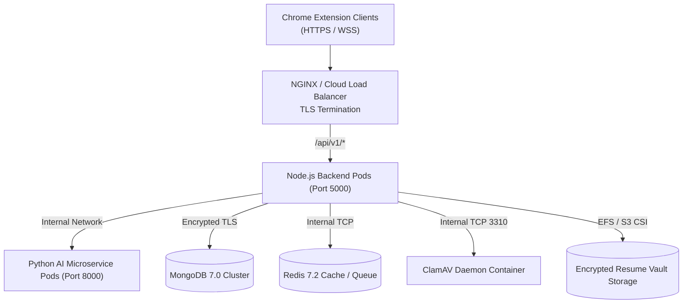

# Production Deployment & Rollback Guide — Applier 3.0

This guide details containerization, production deployment procedures, health monitoring, and rollback strategies for the Applier 3.0 backend and AI microservice.

---

## 1. Production Architecture Overview

In production, Applier is deployed as containerized microservices behind a TLS-terminating load balancer:



---

## 2. Docker Compose Production Configuration

The root `docker-compose.yml` configures the multi-container stack:

```yaml
version: '3.8'

services:
  backend:
    build:
      context: ./backend
      dockerfile: Dockerfile
    restart: always
    ports:
      - "5000:5000"
    environment:
      - PORT=5000
      - NODE_ENV=production
      - MONGO_URI=mongodb://mongo:27017/applier
      - REDIS_URL=redis://redis:6379
      - PYTHON_API_URL=http://ai-service:8000/api/v1/ai/execute
      - CLAMAV_HOST=clamav
      - CLAMAV_PORT=3310
    depends_on:
      - mongo
      - redis
      - ai-service
      - clamav
    volumes:
      - vault_data:/app/vault/tailored

  ai-service:
    build:
      context: ./ai-service
      dockerfile: Dockerfile
    restart: always
    ports:
      - "8000:8000"
    environment:
      - LLM_PROVIDER=huggingface
      - HF_MODEL=Qwen/Qwen2.5-7B-Instruct
      - ALLOWED_ORIGINS=http://backend:5000
    depends_on:
      - mongo

  clamav:
    image: clamav/clamav:latest
    restart: always
    ports:
      - "3310:3310"

  mongo:
    image: mongo:7.0
    restart: always
    ports:
      - "27017:27017"
    volumes:
      - mongo_data:/data/db

  redis:
    image: redis:7.2-alpine
    restart: always
    ports:
      - "6379:6379"
    volumes:
      - redis_data:/data

volumes:
  mongo_data:
  redis_data:
  vault_data:
```

---

## 3. Deployment Checklist

Before promoting to production:
1. **Secrets Injection:** Supply `JWT_SECRET`, `DOCUMENT_ENCRYPTION_KEY`, and `FIREBASE_PRIVATE_KEY` via cloud key management (AWS Secrets Manager, Google Secret Manager, or HashiCorp Vault). Never pass raw secrets in dockerfiles or environment files.
2. **CORS Hardening:** Update `CORS_ORIGIN` in `backend/.env` with the exact registered Chrome Web Store extension ID:
   ```env
   CORS_ORIGIN=chrome-extension://abcdefghijklmnopqrstuvwxyz123456
   ```
3. **LaTeX Sandbox Isolation:** Ensure the LaTeX engine (`tectonic` or `pdflatex`) runs under an unprivileged user (`nobody` or `appuser`) with `--no-shell-escape` and read-only root filesystem.
4. **Database Backups:** Confirm automated daily snapshot policies on MongoDB replica sets.

---

## 4. Health Checks & Monitoring

* **Liveness & Readiness Probe:**
  `GET http://<backend_host>:5000/api/v1/health`
  Expected response: `HTTP 200 OK`
  ```json
  { "success": true, "message": "Applier API is running" }
  ```
* **AI Microservice Health Probe:**
  `GET http://<ai_service_host>:8000/docs`
  Expected response: `HTTP 200 OK`

---

## 5. Rollback Procedures

If an anomalous regression is detected post-deployment:

### 5.1 Rolling Back Backend / AI Service Containers
1. Re-deploy the previous container tag:
   ```bash
   docker-compose pull backend:<PREVIOUS_TAG> ai-service:<PREVIOUS_TAG>
   docker-compose up -d --no-deps backend ai-service
   ```
2. Verify liveness endpoint:
   ```bash
   curl -f http://127.0.0.1:5000/api/v1/health || exit 1
   ```

### 5.2 Chrome Extension Version Rollback
If a published Chrome Web Store update causes client-side issues:
1. Re-package the previous release ZIP from git tags:
   ```bash
   git checkout tags/v2.9.8
   npm run build:extension
   # Package and submit to Web Store Developer Dashboard
   ```
2. In the Chrome Web Store Developer Console, trigger a roll-forward revision with the restored codebase (Chrome Web Store does not support 1-click downgrades; rollbacks must be published with an incremented version number, e.g. `v3.0.1`).

### 5.3 In-Flight Workflow Session Recovery
Because workflow states are stored durably in MongoDB (`MissingInfoSession` collection), in-flight sessions are not lost during backend container restarts. When the client reconnects, it calls:
`GET /api/v1/missing-info/session/:sessionId/recover`
which restores the session to its exact in-flight state.
