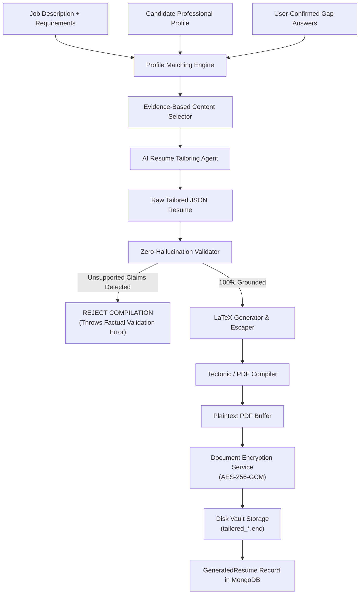

# Resume-Generation Engine & Vault Infrastructure — Applier 3.0

The Applier 3.0 Resume Generation Engine produces tailored, high-impact LaTeX resumes engineered to pass Applicant Tracking Systems (ATS) while maintaining strict zero-hallucination factual integrity.

---

## 1. Core Principles

1. **Strict Evidence Provenance:** Every skill, employment bullet point, project detail, and degree must trace directly to a verified record in the user's `ProfessionalProfile` or a user-confirmed gap clarification answer.
2. **Zero Hallucination:** The AI model is strictly prohibited from inventing employment dates, titles, skills, or metrics. If an unsupported claim is detected, compilation is aborted.
3. **At-Rest Vault Encryption:** All generated PDFs are encrypted using AES-256-GCM before being stored on disk.

---

## 2. LaTeX Template Registry

Applier includes three production LaTeX templates in [`ai-service/services/latex_template_registry.py`](file:///f:/Applier/ai-service/services/latex_template_registry.py):

| Template ID | Target Persona / Use Case | Layout Characteristics |
| :--- | :--- | :--- |
| **`ATS_SINGLE_COLUMN`** | Enterprise & High-Volume ATS (Workday, Taleo, Greenhouse) | Linear single-column layout, zero tables, standard fonts, pure semantic headings. Maximum parse rate across legacy ATS parsers. |
| **`TECHNICAL`** | Software Engineers, DevOps, Systems Architects | Emphasizes technical skills matrix, GitHub/portfolio links, open-source projects, and architecture achievements. |
| **`MODERN_PROFESSIONAL`** | Product Managers, Executives, Consultants | Elegant modern typography, clear section hierarchy, metric-focused summaries, compact margins. |

---

## 3. Resume Tailoring & Evidence Selection Pipeline



### LaTeX Sanitization:
Candidate inputs are sanitized through [`latex-escaper.js`](file:///f:/Applier/backend/src/vault/latex-escaper.js) before insertion into template placeholders:
* `&` $\to$ `\&`
* `%` $\to$ `\%`
* `$` $\to$ `\$`
* `#` $\to$ `\#`
* `_` $\to$ `\_`
* `{` $\to$ `\{`
* `}` $\to$ `\}`
* `~` $\to$ `\textasciitilde{}`
* `^` $\to$ `\textasciicircum{}`

---

## 4. Zero-Hallucination Validation Algorithm

Prior to compilation, [`resume_validator.py`](file:///f:/Applier/ai-service/services/resume_validator.py) analyzes the generated JSON resume against the candidate's canonical evidence:

1. **Skill Grounding Check:** Compares every skill against `[verifiedSkills + confirmedGapSkills]`.
2. **Company & Date Grounding Check:** Matches every experience entry against verified profile employers and dates.
3. **Degree & Institution Grounding Check:** Ensures no academic honors, degrees, or universities were hallucinated.

```python
# Validation Report Schema
{
    "isValid": True,
    "isHallucinationFree": True,
    "unsupportedClaims": [],
    "verifiedSkillsCount": 12,
    "confirmedGapsIncluded": 2
}
```

If `unsupportedClaims` contains any entry, the workflow transitions to `WorkflowState.FAILED` with message:
`Zero-Hallucination audit failed: unsupported claims detected: [...]`.

---

## 5. Encrypted Vault Storage Architecture

Generated resumes are stored in `backend/vault/tailored/`:

* **File Format:** Binary package containing `[12-byte IV] + [16-byte Auth Tag] + [AES-256-GCM Ciphertext]`.
* **File Naming:** `tailored_<userId>_<timestamp>_<sanitizedJobTitle>.enc`.
* **Key Derivation:** SHA-256 hash of `DOCUMENT_ENCRYPTION_KEY`.
* **Access Control:** Resumes can only be decrypted via authenticated API call:
  `GET /api/v1/vault/resumes/tailored/:resumeId/preview`
  which checks that `req.user.id === resume.userId`.
